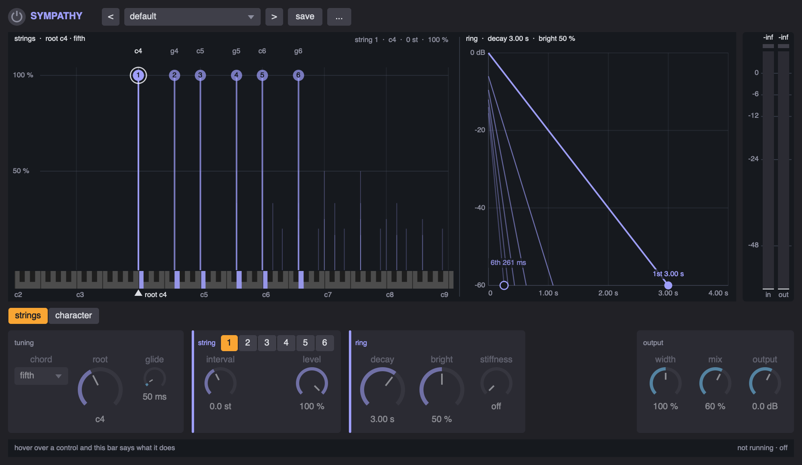

# Sympathy

**Six tuned voices that ring when the sound touches them - hold a piano's pedal down and shout into it - running anywhere a UGen does, with a window.** A SuperCollider extension.



```supercollider
s.boot;
Ndef(\drums, { Sympathy.ar(Decay2.ar(Impulse.ar(2), 0.002, 0.05) * PinkNoise.ar(0.6 ! 2), \sympathy) }).play;

y = Sympathy(Ndef(\drums), \sympathy);
y.gui;
y.root = 48; y.chord = \min9;
y.decay = 6; y.bright = 0.7;
y.tune(1, 7, 0.8);                // the second voice a fifth above the root, at 80%
y.preset = 'gamelan';
```

Every effect of this family lives in the same three places. Write `Sympathy.ar` into a graph of your own and drive it from the object, as above; give it a node of its own on a bus, `Sympathy.onBus(0, 2).enabled_(true)`; or put it in a chain, `FxChain.master.add(Sympathy())`. If SuperDirtGUI is installed, it is an insert on an orbit too: `~sdg.addInsert(0, \sympathy)`.

It is built on [FxKit](https://github.com/fracnesco/sc-fx-kit), and the class library will not compile without it; the installer links it when the folders sit side by side. It uses SuperCollider's own UGens, not sc3-plugins.

Written for SuperCollider 3.13 on macOS. Nothing in it is platform specific apart from the symlink in `install.scd`, which Linux shares and Windows does not.

## Install

### As a quark

```supercollider
Quarks.install("https://github.com/fracnesco/sc-sympathy.git");
thisProcess.recompile;
```

The manifest names `sc-fx-kit` as a dependency, so `Quarks` fetches that first. The quark goes by the name of the repository, `sc-sympathy`; the class inside it is `Sympathy`.

### From a clone

Clone `sc-fx-kit` into a folder called `sc fx kit` and this into `sc sympathy`, side by side. Open `install.scd` and evaluate its first block, then recompile the class library. It links what is missing and tells you what it did.

On Windows there is no `ln -s`, so use the quark, or copy the three folders into the extensions folder by hand: `Platform.userExtensionDir.openOS` opens it.

Install it one way or the other, **not both**: two copies on the class path is a duplicate class error at compile time.

### Check that it took

```supercollider
Sympathy.presetNames;
Sympathy.onBus(0, 2).enabled_(true).gui;
```

Select `Sympathy` and press cmd/ctrl + d for the help file, and see [examples/sympathy-demo.scd](examples/sympathy-demo.scd) for a walkthrough you can evaluate a block at a time.

## What it does

Each voice is six resonators tuned to the harmonics of a note: `inharm` stretches them as a stiff string's are, and the high ones ring for less time as `bright` comes down. What comes in sets them going, and they answer in the chord.

A voice is a distance from `root` in semitones, `note1..6`, and a level, `level1..6` (0 is off). `chord` sets all six at once, from the names in `Sympathy.chordNames`, and is a command rather than a setting, so a preset holds the notes it made; `y.chord` answers the chord the voices make now, or nil.

Their level follows the input, so a long decay on a steady input gets loud, and they are limited softly on the way out. Measured on one hit of noise, `decay` is the time to about 60 dB down.

It is 72 `Ringz` at stereo, and about 3% of one core on an M4 Pro.

## The window

`y.gui` opens it (`y.panel(view)` puts the same thing in a view of yours): the top row (on, presets, save, the menu with copy and paste), the display with the in and out meters beside it, and two pages of cards. Hover over anything and the bar at the bottom says what it does. The strings, their heads, the ring lines and the hero knobs are lilac: what Sympathy adds. Blue is what passes.

The display has two parts:

- **strings** - pitch along, a keyboard at the bottom with the octaves named as Tidal names them (c5 is note 0) and the root marked under it. Each voice is a string standing on its key, as tall as its level, numbered as in the string card, its note named above; a string at 0 is a hollow circle at the bottom, one off the keys an arrow at the edge. The thin lines further up are its harmonics, pulled sharp by `inharm`. Behind them in blue, the output's spectrum on the same keys. While it runs, a string that rings swells and shakes, as wide as it is loud: the server's own reading of each voice.
- **ring** - a hit falling away: dB down, seconds along, a line per harmonic, the lowest thick. `decay` is where the lowest reaches -60 dB, `bright` how much sooner the high ones get there. Behind them in blue, what the strings did since the last hit. When they build up past what the soft limit lets through, the corner says by how much it holds them down (`limit -4.8 dB`, in the colour of gain change).

| in the display | does |
|---|---|
| click a string | picks it: the string card shows that voice |
| drag a string along | its note (`note1..6`), a key at a time; shift for tenths |
| drag a string up and down | its level (the first move says which) |
| double click a string | back to full level |
| click a key | the picked string to that note |
| drag the root mark, or the wheel over the strings | `root`, every string with it; double click the mark: back to c4 |
| drag the ring's filled handle | `decay` |
| drag the ring's hollow handle (the 6th's end) | `bright` |
| drag elsewhere in the ring | along: `decay`; up and down: `bright`; shift for fine |
| the wheel over the ring | `inharm` (stiffness) |
| double click the ring | `decay` and `bright` back to 3 s and 50 % |

Page **strings**: *tuning* - the chord menu (it says which chord the strings make now, or "own"), root (as a note: type `e3`), glide - then *string* with its 1-6 selector (interval and level of one voice; a voice at 0 dims its number), then *ring* - decay, bright, stiffness (`inharm`; right click it for piano, bell, metal). Page **character**: *excite* - input, lo cut, hi cut, the filter in front of the strings - and *wobble* - detune, wander (`vibrato`), rate. The *output* card is on both: width, mix, output.

## Presets

Built in: default, piano lid, long fifths, gamelan, dark room, cluster bloom, major halo, metal sheet, wobble choir.

Yours go in `Platform.userAppSupportDir/sympathy-presets.scd`: `y.saveAsPreset("mine")`, or press save in the window and give it a name. `y.copySettings` and `other.pasteSettings` carry settings from one to another.

## Parameters

Every parameter is a property: `y.root`, `y.root = ...`. These also work by name, `y.set(\root, ...)`, `y.get(\root)`. Knobs clip to their range. This table is generated from the class.

| parameter | section | range | default | what it does |
|---|---|---|---|---|
| `root` | tuning | 24 .. 84 midi | 48 | the note every string is counted from - type a name (e3) or a number |
| `note1` | string 1 | -24 .. 36 st | 0 | string 1, in semitones from the root |
| `note2` | string 2 | -24 .. 36 st | 7 | string 2, in semitones from the root |
| `note3` | string 3 | -24 .. 36 st | 12 | string 3, in semitones from the root |
| `note4` | string 4 | -24 .. 36 st | 19 | string 4, in semitones from the root |
| `note5` | string 5 | -24 .. 36 st | 24 | string 5, in semitones from the root |
| `note6` | string 6 | -24 .. 36 st | 31 | string 6, in semitones from the root |
| `glide` | tuning | 0 .. 1 s | 0.05 | how long a string takes to reach a new note |
| `decay` | ring | 0.05 .. 30 s | 3 | how long the lowest harmonic rings, to -60 dB |
| `bright` | ring | 0 .. 1 | 0.5 | how long the high harmonics ring against the low ones: dark, they die first |
| `inharm` | ring | 0 .. 0.02 | 0 | the harmonics stretched sharp, as on a stiff string: at 1 % the 6th is nearly a minor third sharp |
| `detune` | wobble | 0 .. 50 c | 4 | the sides apart, in cents: slow beating |
| `vibrato` | wobble | 0 .. 1 | 0 | how far each string drifts off its note, slowly and at random: at most a semitone |
| `vibratoRate` | wobble | 0.05 .. 12 Hz | 3 | how quickly the strings wander |
| `hiCut` | excite | 200 .. 20000 Hz | 12000 | a low pass on what goes in: what is above it does not reach the strings |
| `loCut` | excite | 20 .. 2000 Hz | 40 | a high pass on what goes in: what is below it does not reach the strings |
| `input` | excite | -24 .. 24 dB | 0 | how hard the strings are played |
| `width` | output | 0 .. 2 | 1 | how far apart the sides are |
| `mix` | output | 0 .. 1 | 0.6 | how much of the effect goes out, against the dry signal |
| `output` | output | -36 .. 24 dB | 0 | the level of the whole thing, in dB |

`level1..6` (0 .. 1, default 1), each right after its `note` in the node's order, are the voices' levels.

## Files

| file | what it is |
|---|---|
| [classes/Sympathy.sc](classes/Sympathy.sc) | the parameters, the presets, the DSP |
| [classes/SympathyView.sc](classes/SympathyView.sc) | the window's display, and `SympathyPanel`, the window's controls |
| [HelpSource/Classes/Sympathy.schelp](HelpSource/Classes/Sympathy.schelp) | the help file |
| [HelpSource/Classes/SympathyView.schelp](HelpSource/Classes/SympathyView.schelp) | the help file for the display |
| [HelpSource/Classes/SympathyPanel.schelp](HelpSource/Classes/SympathyPanel.schelp) | the help file for the window's controls |
| [examples/sympathy-demo.scd](examples/sympathy-demo.scd) | a walkthrough, one block at a time |
| [install.scd](install.scd) | the symlink, a check, an uninstall |
| [sc-sympathy.quark](sc-sympathy.quark) | the quark manifest |
| [images/](images/) | the screenshots in this README |

## License

MIT - see [LICENSE](LICENSE).
